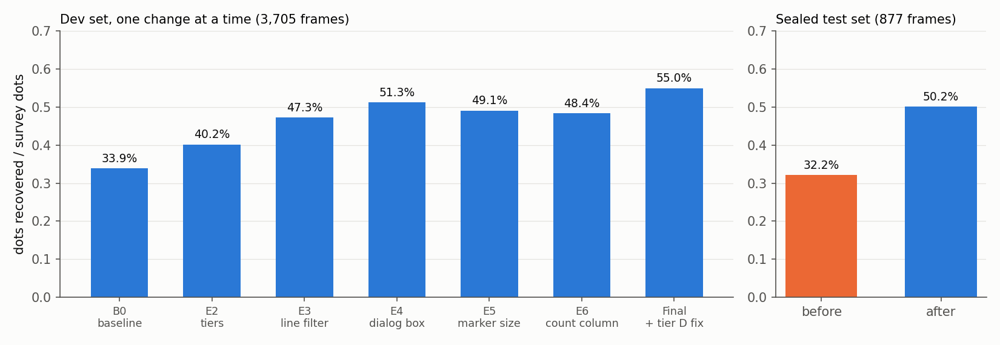
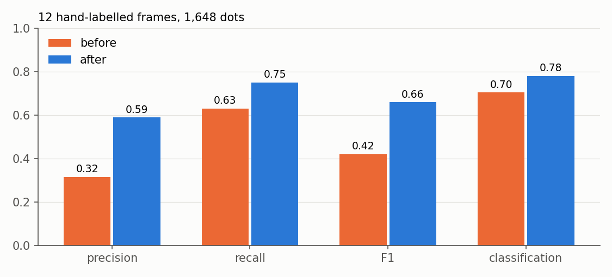
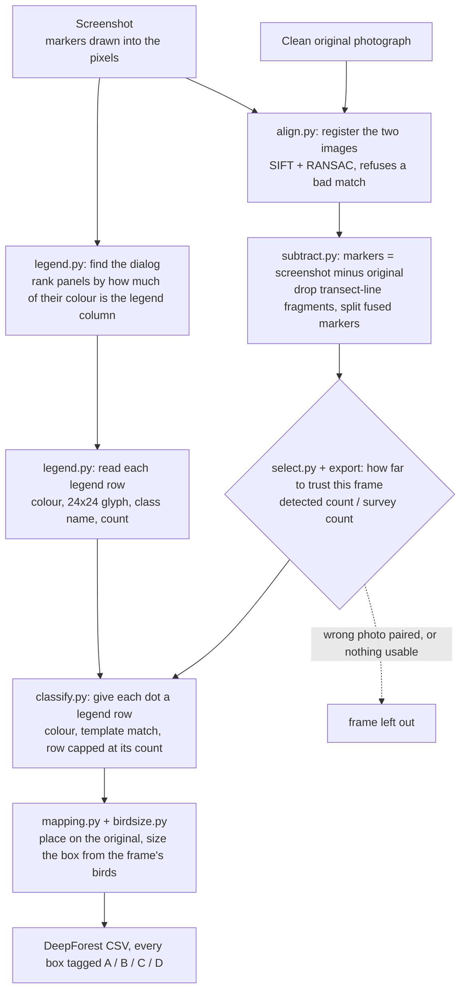
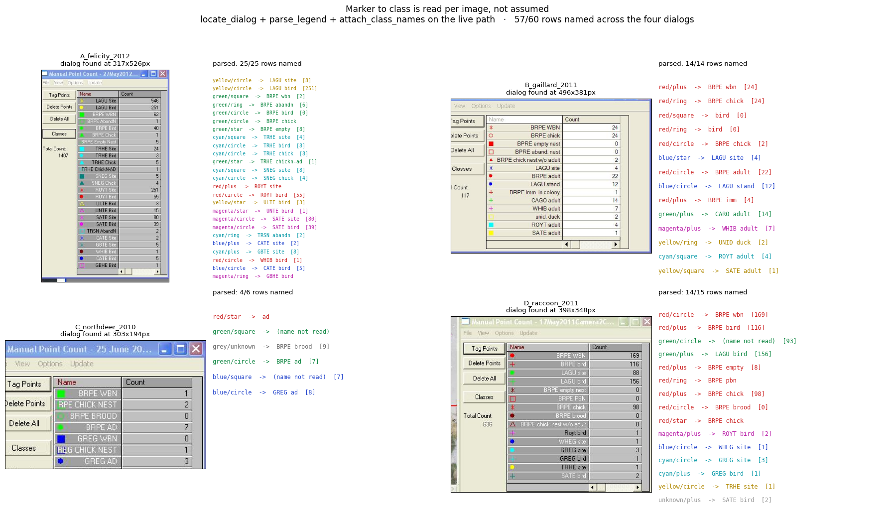
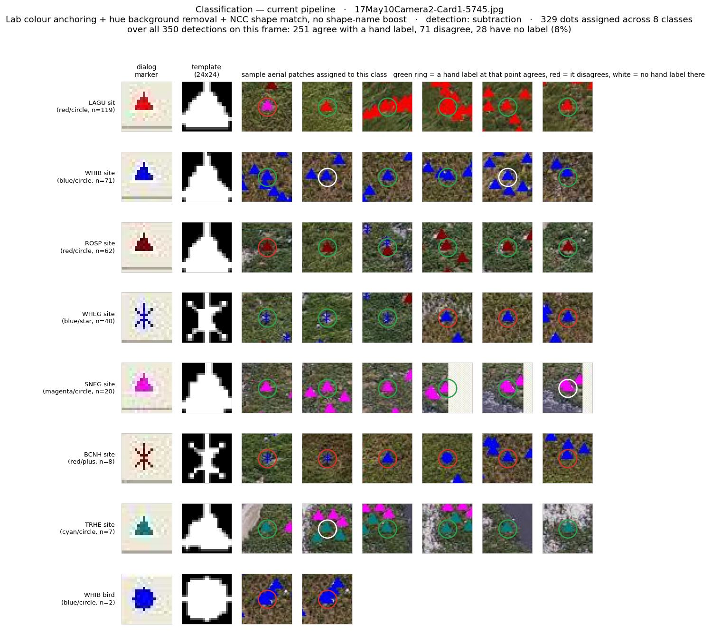
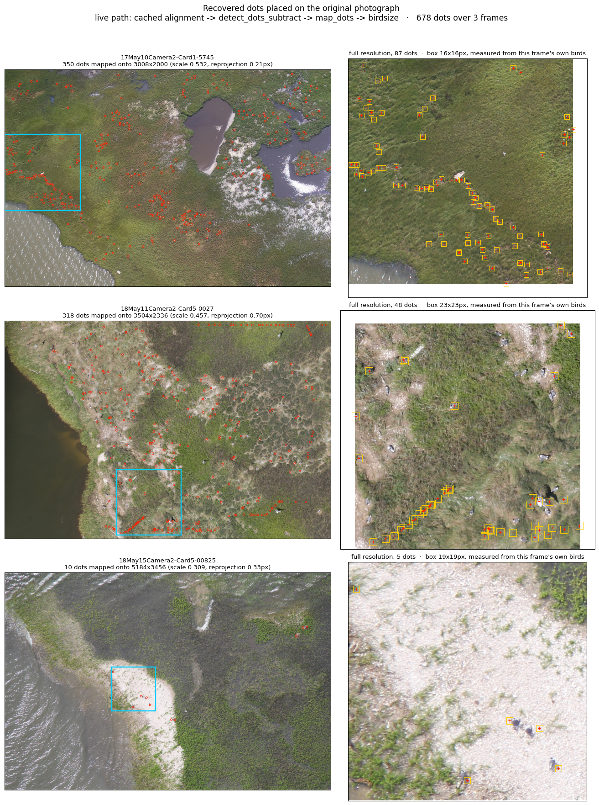
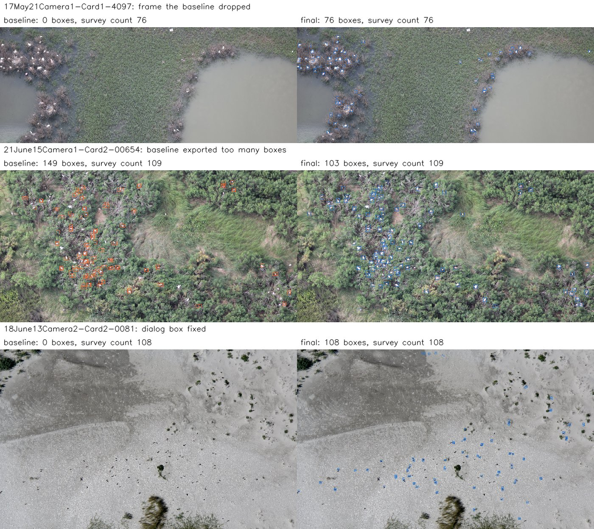
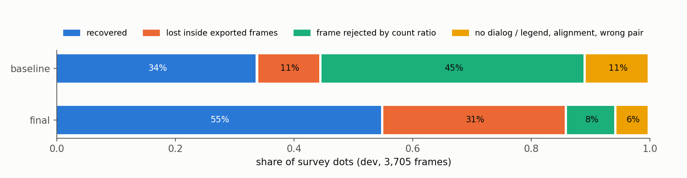
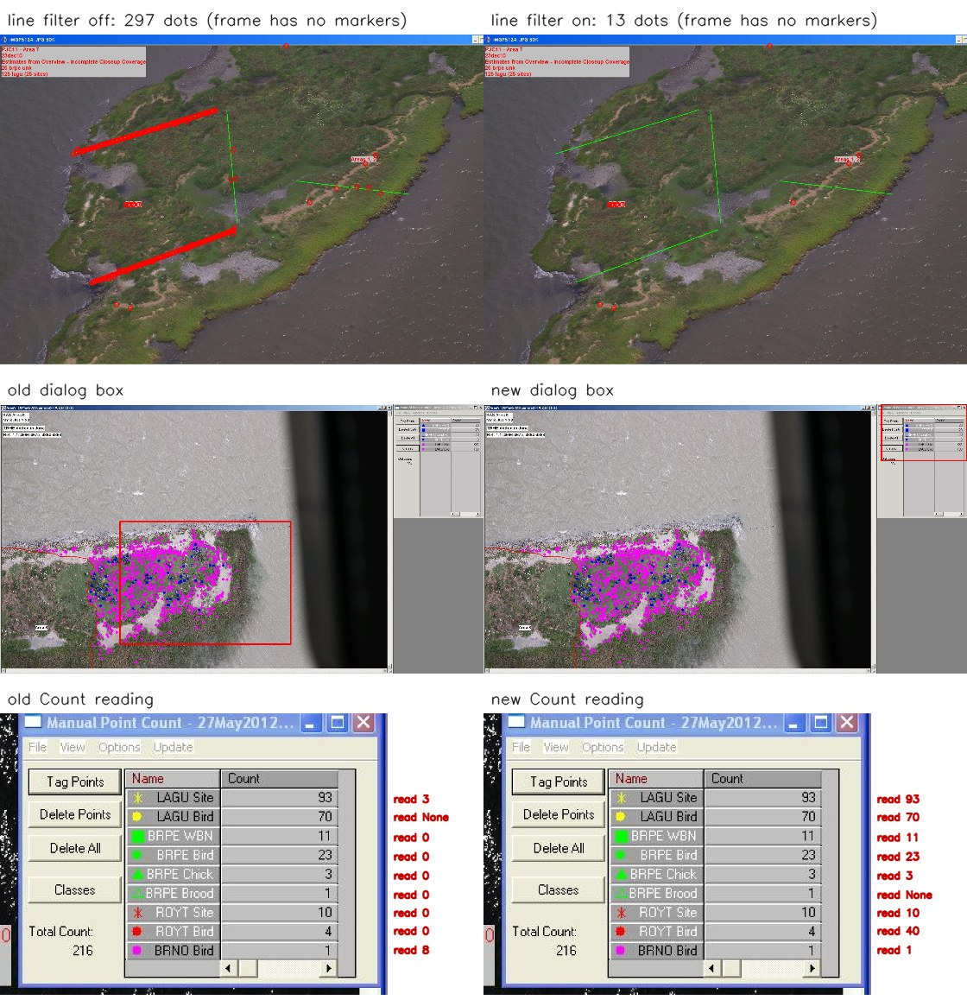
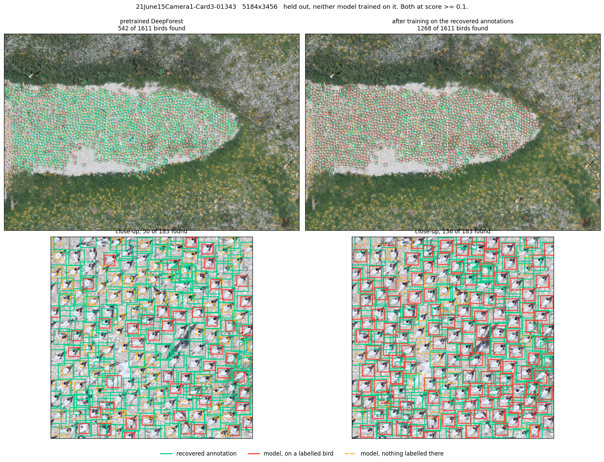

> Developed for [Google Summer of Code 2026](https://summerofcode.withgoogle.com/) under the DeepForest project (WeeCology).

# Weecology: Recovering Bird Annotations from Historical Airborne Imagery

Between 2010 and 2021, surveyors counted birds on Gulf of Mexico aerial photographs with a
point-counting tool. The tool drew a coloured marker on the photograph for every bird and
saved a screenshot. It never saved the coordinates. What remains is **18,304 screenshots**
holding 2.81 million bird markers in their pixels, and the clean high-resolution
photographs they were drawn on.

This project reads the markers back out. For each screenshot it finds every marker, works
out its species and category from that screenshot's own legend, places it on the original
photograph, and writes DeepForest training data.


Left: a screenshot, with the tool's markers and its legend dialog drawn over the
photograph. Right: the same photograph, clean.

Data: `twi-aviandata.s3.amazonaws.com`, from [The Water Institute](https://thewaterinstitute.org/)
(Gulf of Mexico avian monitoring after Deepwater Horizon).

## Results

The pipeline works from the two images alone. The survey's per-image count is used to
choose which frames to trust and to score the output, never to place or label a marker.

**On 877 frames held back from all development** (the sealed test set):

| | before this round | now |
|---|---|---|
| Markers recovered, as a share of the survey count | 32.2% | **50.2%** |
| Same, weighted to the whole corpus | 31.3% | **58.5%** |
| Frames that give any annotations | 279 | **642** |
| Annotations recovered | 87,868 | **137,219** |
| Annotations above the survey count, so surely false | 3,998 | **3,925** |

**On 12 hand-labelled frames (1,648 markers placed by hand):**

| | before | now |
|---|---|---|
| Precision: share of output dots on a real marker | 0.315 | **0.588** |
| Recall: share of real markers found | 0.630 | **0.749** |
| Class correct, per matched dot | 0.703 | **0.780** |





The dataset built from this run holds **742,690 boxes on 3,380 photographs**
([below](#the-dataset)). How each step was measured, and what each one changed, is in
[`docs/recovery_experiments.md`](docs/recovery_experiments.md).

## How it works



### Reading the legend

Each screenshot has a floating dialog listing every class, its marker and its count. The
marker for a class changes from image to image: a red plus is `BRPE wbn` in one survey and
`BRPE bird` in another. So the pipeline reads each dialog on its own and cuts a 24x24
template from each row's glyph. Tesseract reads the class names, matched against 98
species codes.



57 of the 60 rows on these four dialogs get a name. The numbers in brackets are the counts
read from the Count column. Counts still misread on small dialogs: on dialog A,
`LAGU site` reads 8 where the dialog says 546. Redraw with `python scripts/make_legend_figure.py`.

### Finding the markers

The clean original exists, so a marker is whatever the screenshot has and the original
lacks. `align.py` registers the two images; `subtract.py` takes the difference.

Two things in the difference are not markers. Transect lines and area outlines are drawn
in the markers' own colours, so dots within 6 px of a long thin line are dropped. And in
colonies, touching markers fuse into one blob, so each blob is split by its area over the
typical marker area, taken as the median blob area on that frame.

### Deciding how far to trust a frame

A frame reporting seven times the markers it holds cannot be more than 14% precise,
whatever is done afterwards. `src/select.py` turns that into a band on
`detected / survey count`. Frames are no longer dropped for leaving the band. Every box
carries a tier instead:

| tier | the frame | what is exported |
|---|---|---|
| A | count within the band, legend read | every dot the legend accepts |
| B | finds too few | only dots the legend accepts |
| C | finds too many | judged again on the dots the legend accepts |
| D | no legend, count within the band | every dot, labelled `Bird` |

Frames whose title bar names a different photo from the file, and whose registration is
weak, are left out: about 2% of screenshots are filed against the wrong original.

### Giving each dot a class

The class of a dot is the legend row it is matched to, not the name read off that row:
one dialog has two rows that both read `ad`.

- **Colour picks candidate rows**, using that dialog's own palette in Lab. The colour shift
  between a crisp legend glyph and a thin marker on vegetation is measured per row.
- **A template match ranks them**, with colour agreement in the score.
- **Each row is capped at the count the dialog states.** A dot whose best row is full goes
  to its next best row.
- **A dot that matches no row gets no class.**



Each row shows the dialog's marker, the template cut from it, and aerial patches given that
class. Green ring: a hand label there agrees. Red: it disagrees. White: no hand label
there. On this frame 251 of 350 detections agree with a hand label, 71 disagree and 28 have
none. The large rows are mostly right. The small ones, `BCNH site` (8 dots) and
`WHIB bird` (2 dots), are wrong on every dot. Redraw with
`python scripts/make_classify_figure.py --pair 17May10Camera2-Card1-5745.jpg --rows 8`.

### Placing boxes on the original

`mapping.py` moves each dot from screenshot pixels to the original photograph.
`birdsize.py` measures how large this frame's birds are, because focal lengths from 28 to
300 mm make the same species 10 px on one photograph and 41 px on another.



## The dataset

```
results/dataset_5k/       3,380 photographs, 742,690 boxes   this round
results/dataset_scaled/     413 photographs, 118,270 boxes   August run
results/dataset/             25 photographs,   6,420 boxes   benchmark
```

`results/dataset_5k/` is built by `scripts/build_dataset_5k.py`:

| file | contents |
|---|---|
| `annotations_deepforest.csv.gz` | `image_path, xmin, ymin, xmax, ymax, label` |
| `annotations.csv.gz` | the same boxes with dev/test split, tier, legend row, species flag |
| `frames.csv` | every frame, and why it was or was not exported |

| split | tier A | B | C | D |
|---|---|---|---|---|
| dev | 411,752 | 60,150 | 45,435 | 88,134 |
| test | 99,183 | 12,420 | 10,268 | 15,348 |

`image_path` is relative to `data/fixtures/pairs`. The CSVs are gzipped because the plain
DeepForest file is about 100 MB, GitHub's limit for one file; pandas and DeepForest read
`.csv.gz` directly. Where precision matters, keep tier A.



Boxes from the baseline run (orange) and this round (blue) on three photographs.

## How it is measured

- **5,000 frames**, balanced across 7 survey years and 3 density bands, split into 4,000
  dev and 1,000 test frames. Every change was tried on dev. The test frames were run
  once at the start and once at the end. 8% of the 5,000 frames have no screenshot in the
  S3 bucket and are left out of every figure.
- **Recovery** is annotations recovered over the survey's marker count (`category_sum`).
  Annotations above the survey count on a frame cannot all be real, so their total is a
  floor on false annotations.
- **Hand labels**, 1,648 markers on 12 frames in `data/labels/`, scored by
  `scripts/eval_localisation.py`. Ten of those frames were labelled starting from the
  pipeline's own dots, so placement error is only meaningful on the two labelled blind.



Before this round, 55% of markers sat in frames thrown out whole, 45% of them on the count
ratio alone. Now 14% do, and 31% are lost inside frames that are kept, mostly markers
never detected in dense colonies.

## The changes in this round

| step | change | recovery on dev |
|---|---|---|
| B0 | baseline | 33.9% |
| E2 | keep imperfect frames, tagged by tier | 40.2% |
| E3 | judge over-detecting frames on legend-accepted dots; drop transect-line fragments | 47.3% |
| E4 | find the dialog by how much of a panel's colour is the legend column | 51.3% |
| E5 | marker size from the median blob area | 49.1% |
| E6 | find the Count column from the markers; second digit reader for blank rows | 48.4% |
| final | all of the above, with the tier D fix | 55.0% |

E5 and E6 lower the raw count because they remove false dots: annotations above the
survey count fall from 28,136 after E4 to 8,373 after E6.



Top: a frame with no markers at all, only transect lines. 297 dots without the line
filter, 13 with it. Middle: the old ranking took a column of birds on a grey beach as the
legend. Bottom: the dialog reads 93, 70, 11, 23; the old reader returned 3, None, 0, 0.

## Training check

Fine-tuning DeepForest's bird model on the August dataset (349 photographs, 60 held out)
raised mAP@50 from 0.036 to 0.087. That is scored against recovered annotations, not
against people. Detail in [`docs/training_analysis.md`](docs/training_analysis.md).



## Known limits

- **Dense colonies of thin outline markers.** Fused blobs raise the median blob area, so
  fused groups split into too few dots. About 11,000 real markers are lost this way on dev.
  Only 2 of the 12 hand-labelled frames are dense, too few to fix it on.
- **Count reading.** 74.5% of legend rows get a count, and on 21% of frames the counts read
  sum exactly to the survey count.
- **Transect lines that break into short pieces** still pass the line filter.
- **Tier D** has no legend check and carries the most noise.
- **Markers fused into a solid patch** have no recoverable positions.

## What did not work

Each of these was measured and dropped. Full reasons in [`docs/learnings.md`](docs/learnings.md).

| approach | result |
|---|---|
| Narrow HSV colour bins | 44% of markers detected |
| Saturation floor against false positives | False positives are more saturated than markers, 204 against 178 |
| Minimum blob area, elongation, legend match score, a learned filter over all four | No consistent signal; the learned filter gained 0.012 F1 while recall fell from 0.597 to 0.177 |
| Reading the dialog's Total Count as a budget | Correct on 11 of 25 frames |
| Capping every row with no readable count at zero | One frame fell from 0.516 to 0.065 |
| Legend glyph size as the marker size | Off by 0.35 to 2.6 times, depending on the frame |
| Texture just outside the original's edge, to catch wrong photo pairs | Reads the same on correct pairs, 0.47 to 0.78 |
| Training on the full early dataset | 0 high-confidence detections |

## Quick start

```bash
pip install -r requirements.txt                                   # full
pip install pytest numpy opencv-python scikit-image PyYAML scipy  # tests only

pytest tests/ -q                       # 241 tests, no data or network needed

python scripts/build_manifest.py       # survey counts
python scripts/build_benchmark.py --per-cell 3
python scripts/eval_localisation.py    # precision, recall, placement, class on hand labels
```

Class-name OCR needs the Tesseract binary as well as `pytesseract`. On Windows:
`winget install UB-Mannheim.TesseractOCR`. Without it the pipeline skips OCR and still runs.

To rerun the 5,000-frame experiments on Kaggle and rebuild the dataset and figures:

```bash
python scripts/kaggle_batch.py snapshot
python scripts/kaggle_batch.py push --tag final --split dev --chunks 5 --align data/cache/align_dev.json
python scripts/kaggle_batch.py pull --tag final --split dev --chunks 5
python scripts/recovery_report.py final --vs b0
python scripts/build_dataset_5k.py
python scripts/make_recovery_figures.py
```

Each change can be switched off for comparison: `TIERS=0`, `OVER_ASSIGN=0`,
`WRONG_PAIR_GUARD=0`, `LINE_FILTER=0`, `MODAL=dt`, `DIALOG_SHARE=0`, `COUNT_GEOM=0`,
`COUNT_OCR=orig`. Tunable values live in `config.yaml`.

## Repository

```
src/legend.py         find the dialog; read each row's colour, glyph, name and count
src/align.py          register the original onto the screenshot
src/subtract.py       markers as image difference; line filter; split fused markers
src/select.py         the trust band on detected / survey count
src/classify.py       colour per row, template match, capacity per row
src/title_check.py    photo number from the title bar, to catch wrong pairs
src/mapping.py        screenshot pixels to original pixels
src/birdsize.py       bird size per frame, for the box
scripts/              export, Kaggle runs, reports, evaluation, figures
tests/                241 tests
data/labels/          1,648 hand-labelled markers on 12 frames
results/dataset*/     the DeepForest datasets
docs/                 write-ups
blog/                 the six-part blog series
notebook/             training notebooks
```

`src/decompose.py` and `src/detect.py` are kept for reference and are not used.

## Documentation

| | |
|---|---|
| [`docs/recovery_experiments.md`](docs/recovery_experiments.md) | This round: each change, its effect, and what was dropped |
| [`docs/learnings.md`](docs/learnings.md) | Every dead end, with its cause |
| [`docs/training_analysis.md`](docs/training_analysis.md) | The DeepForest training runs |
| [`docs/labelling_findings.md`](docs/labelling_findings.md) | How the hand labels were made |
| [`blog/`](blog/) | The six-part write-up |

Blog: **[vickysharma.hashnode.dev](https://vickysharma.hashnode.dev/)**.
Other contributions: **[github.com/search?q=author:vickysharma-prog](https://github.com/search?q=author%3Avickysharma-prog&type=pullrequests&s=created&o=desc)**.

Built with guidance from the DeepForest maintainers at Weecology, and with thanks to
[The Water Institute](https://thewaterinstitute.org/) for the archive and for their input in
[discussion #6](https://github.com/vickysharma-prog/Recovering-computer-vision-annotations/discussions/6).

## License

MIT. See [LICENSE](LICENSE).
